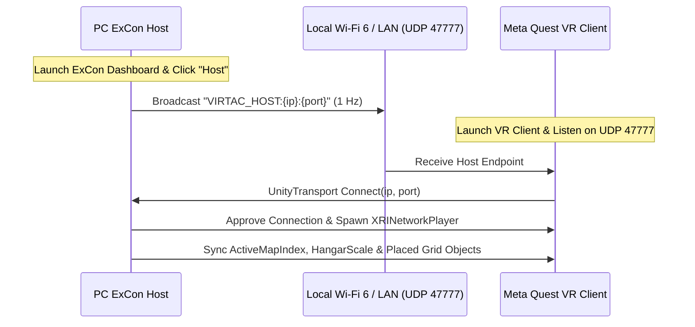
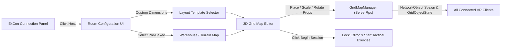

# VR Tactical Engagement Simulator (VirTac)

[](https://unity.com/)
[](https://docs.unity3d.com/Packages/com.unity.render-pipelines.universal@17.3/)
[](https://docs-multiplayer.unity3d.com/)
[](https://docs.unity3d.com/Packages/com.unity.xr.interaction.toolkit@3.3/)
[](LICENSE)

**VR Tactical Engagement Simulator (VirTac)** is a local multiplayer Virtual Reality Close-Quarters Battle (CQB) and tactical engagement training platform built in **Unity 6**.

Designed around an asymmetric **PC Exercise Controller (ExCon Host) + Standalone VR Trainee (Meta Quest Client)** architecture, VirTac enables an instructor on a desktop station to configure room dimensions, design modular kill-house layouts on a snapped 3D grid, switch between pre-baked combat environments, spawn AI combatants, and supervise live multi-trainee VR exercises over a low-latency offline LAN.

---

## Table of Contents

1. [System Architecture & Concept](#1-system-architecture--concept)
2. [Key Features](#2-key-features)
3. [System Workflows](#3-system-workflows)
4. [Tech Stack & Packages](#4-tech-stack--packages)
5. [Project Directory Structure](#5-project-directory-structure)
6. [Getting Started & Deployment](#6-getting-started--deployment)
7. [ExCon Operator Controls](#7-excon-operator-controls)
8. [Development Roadmap](#8-development-roadmap)
9. [License](#9-license)

---

## 1. System Architecture & Concept

VirTac compiles from a **single unified Unity project codebase** into two distinct operational builds sharing identical network protocols, physics colliders, and modular prefabs:

| Role | Target Platform | Primary Scene | Input & UI Paradigm | Core Responsibilities |
| :--- | :--- | :--- | :--- | :--- |
| **PC ExCon Host** | Windows Standalone (`x86_64`) | `Assets/Scenes/VRTac Host.unity` | Desktop 2D Canvas + Orthographic/Perspective 3D Map Editor (Mouse & Keyboard) | Authoritative NGO Host/Server, UDP LAN broadcaster, procedural hangar sizing, real-time CQB grid editor, AI spawner, and session monitor. |
| **VR Trainee Client** | Android (`ARM64` Meta Quest 2/3/Pro) / PCVR OpenXR | `Assets/Scenes/VRtac Clent.unity` / `VR_Client_Scene.unity` | 3D Spatial World UI, XR Controllers, Hand Tracking & Physical Rifle Stock Trigger | Auto-discovers LAN host, renders synchronized environments, replicates full-body/IK VR avatars, handles ballistic weapon firing & tactical traversal. |

### Why a Single Unified Codebase?
- **Deterministic Network Parity**: Both the PC Host and Quest VR Clients compile the exact same `NetworkBehaviour` scripts, `NetworkVariable` definitions, and RPC signatures (`GridMapManager`, `WarehouseNetworkSync`, `NetworkWeapon`, `EmeraldAINetworkBridge`), preventing protocol mismatch errors.
- **Authoritative Server Validation**: The PC ExCon Host acts as the authoritative server for hit registration, AI NavMesh pathfinding, and dynamic obstacle placement—requiring direct access to the same prefabs and colliders used on the VR client.
- **Rapid Dual-Mode Iteration**: Developers can test both the PC ExCon dashboard and VR interactions within the Unity Editor using XR Device Simulator, Quest Link, or Multiplayer Play Mode.

---

## 2. Key Features

### Offline LAN Networking & Automatic UDP Discovery
- **Zero Cloud Dependency**: Uses `UnityTransport` over local Wi-Fi 6 / Gigabit LAN for sub-10ms round-trip latency without requiring external internet access.
- **Automatic Host Discovery (`LanDiscovery.cs`)**: The PC ExCon Host broadcasts `VIRTAC_HOST:{ip}:{port}` via UDP on port `47777` every second. VR headsets listening on the subnet automatically detect and join the active training session without manual IP entry.
- **Optional Cloud & Voice Integration**: Includes support for Unity Gaming Services Authentication, Multiplayer Sessions, and **Vivox** spatial 3D voice chat (`VoiceChatManager.cs`).

### Multi-Environment Tactical Arena (`GridMapManager.cs` & `WarehouseNetworkSync.cs`)
The Exercise Controller can dynamically configure and switch between **three synchronized training environments** (`ActiveMapIndex`):
1. **Procedural Modular Hangar (`ActiveMapIndex = 0`)**:
   - Configurable room width, length, and height via live 2D rectangle and 3D container previews (`ExConRoomConfigUI.cs`).
   - Supports preset layout templates (`ExConLayoutTemplate.cs`) and real-time custom building.
2. **Pre-Baked Industrial Warehouse (`ActiveMapIndex = 1`)**:
   - Multi-room CQB interior with pre-baked lightmaps and automatic VR trainee spawn point relocation.
3. **Outdoor Tactical Terrain Map (`ActiveMapIndex = 2`)**:
   - Large-scale outdoor compound with natural cover, foliage, and long-range engagement sightlines.

### Real-Time ExCon 3D Grid Map Editor (`ExConGridEditor.cs` & `ExConEditorPanelUI.cs`)
- **Snapped Grid Placement**: `3.0m x 3.0m` cell grid with live translucent ghost previews, floor-offset alignment, and `90°` step rotation.
- **Dynamic Wall Scaling**: Adjustable wall length and height sliders for procedural partitions (`GridObjectState.cs`).
- **9 Placeable Tactical Prefabs**:
  - `0`: Solid Wall
  - `1`: Window Wall
  - `2`: Doorway Wall
  - `3`: Corner Junction
  - `4`: Breach House Module
  - `5`: Watchtower
  - `6`: Industrial Cargo Container
  - `7`: Concrete Jersey Barrier
  - `8`: Tactical Sandbag Emplacement
- **Camera Perspectives**: Instant toggle between top-down **Orthographic** blueprint view and **Perspective** 3D inspection view, with player avatar layer culling for unobstructed planning.

### VR Trainee Ballistics & Physical Rifle Prop Integration (`NetworkWeapon.cs`)
- **Mechanical Rifle Prop Ready**: Calibrated for physical rifle stocks where a mechanical linkage actuates the Quest controller trigger—delivering realistic cheek weld and trigger pull with zero Bluetooth/microcontroller latency.
- **Networked Ballistics & VFX**: Server-authoritative raycast damage calculation (`IDamageable`), synchronized 3D bullet tracer lines, muzzle flash activation, and 3D spatial gunshot audio.
- **XR Avatar & Hand Replication**: Synchronizes head, hand joints (`XRHandPoseReplicator.cs`), inverse kinematics (`XRAvatarIK.cs`), andholstered/held weapons (`NetworkPlayerWeaponHolder.cs`).

### Host-Authoritative Tactical AI (`EmeraldAINetworkBridge.cs` & `NetworkEnemySpawner.cs`)
- Bridges **Emerald AI** behavior trees and Unity **AI Navigation (`NavMeshAgent`)** with **Netcode for GameObjects**.
- Server-side AI decision-making, target acquisition against networked VR players, synchronized locomotion/attack animations, and network-replicated health and ragdoll death states.

---

## 3. System Workflows

### LAN Discovery & Session Lifecycle


### ExCon Room Configuration & Map Synchronization


---

## 4. Tech Stack & Packages

| Component | Package / Version |
| :--- | :--- |
| **Engine** | Unity `6000.3.5f1` (Unity 6) |
| **Render Pipeline** | Universal Render Pipeline (`com.unity.render-pipelines.universal` `17.3.0`) & Shader Graph `17.3.0` |
| **Networking** | Netcode for GameObjects (`com.unity.netcode.gameobjects` `2.8.0`), Multiplayer Tools `2.2.6` |
| **XR Framework** | XR Interaction Toolkit (`com.unity.xr.interaction.toolkit` `3.3.1`), OpenXR (`1.16.1`), XR Hands (`1.7.2`), AR Foundation (`6.3.2`) |
| **Voice & Cloud Services** | Unity Services Multiplayer (`2.0.0`), Authentication (`3.6.0`), Vivox (`16.9.0`) |
| **AI & Navigation** | Unity AI Navigation (`com.unity.ai.navigation` `2.0.14`) + Emerald AI |
| **Input & Camera** | Unity Input System (`1.17.0`), Cinemachine (`3.1.7`) |

---

## 5. Project Directory Structure

```text
Virtac/
├── Assets/
│   ├── Scenes/
│   │   ├── VRTac Host.unity              # Primary PC ExCon Host & Map Editor scene
│   │   ├── VRtac Clent.unity             # Primary Meta Quest VR Client scene
│   │   ├── VR_Client_Scene.unity         # Lightweight VR Client scene
│   │   └── Layout Warehouse Scene.unity  # Warehouse environment layout scene
│   ├── VRMPAssets/
│   │   ├── Prefabs/
│   │   │   ├── GridObjects/              # Modular walls, doors, windows, containers, barriers
│   │   │   └── PlayerPrefabs/            # Networked XR Origin & Avatar prefabs
│   │   ├── Scripts/
│   │   │   ├── Data/                     # ExConLayoutTemplate ScriptableObject definitions
│   │   │   ├── Editor/                   # Scene sync wizards, grid setup & auto-fix tools
│   │   │   ├── Gameplay/                 # GridMapManager, ExConGridEditor, NetworkWeapon,
│   │   │   │                             # WarehouseNetworkSync, EmeraldAINetworkBridge, AI spawners
│   │   │   ├── Helpers/                  # Object pooling, VR diagnostics, XR knobs/levers
│   │   │   ├── Network/                  # LanDiscovery, XRINetworkGameManager,XRINetworkPlayer,
│   │   │   │                             # SessionManager, VoiceChatManager, NetworkInteractions
│   │   │   ├── Player/                   # XR hand tracking, avatar customization, HUD notifications
│   │   │   └── UI/                       # ExConDashboardUI, ExConRoomConfigUI, ExConEditorPanelUI,
│   │   │                                 # ExConInventoryPanelUI, ExConLayoutSelectUI, LobbyUI
│   │   └── Materials/Audio/Meshes/       # Core tactical simulation assets
│   ├── Resources/                        # Runtime-loaded weapon audio, animators & network prefabs
│   ├── Settings/                         # URP renderer & quality profiles
│   └── XR/ & XRI/                        # OpenXR & XR Interaction Toolkit configuration assets
├── Packages/
│   └── manifest.json                     # Unity Package Manager dependencies
├── ProjectSettings/                      # Input, tags, layers, XR plug-in & build settings
├── ROADMAP.md                            # Architectural design notes & milestone breakdown
├── LICENSE                               # MIT License & third-party asset notice
└── README.md                             # Project documentation
```

---

## 6. Getting Started & Deployment

### Prerequisites
1. **Unity Hub** with **Unity `6000.3.5f1`** installed, including:
   - **Windows Build Support (IL2CPP / Mono)**
   - **Android Build Support** (OpenJDK, Android SDK & NDK Tools) for Meta Quest builds
2. A **Meta Quest 2 / 3 / Pro** headset (or OpenXR-compatible HMD) connected to the same local network (Wi-Fi 6 router recommended) as the PC ExCon Host.

### Opening the Project
1. Clone this repository:
   ```bash
   git clone https://github.com/Tauseefyusufzai/VR_Tactical_Engagement_Simulator.git
   cd VR_Tactical_Engagement_Simulator
   ```
2. Open the project folder in **Unity Hub** using editor version `6000.3.5f1`.
3. Allow Unity to import packages and compile assemblies (`VRMP.asmdef`, `EmeraldAI.asmdef`, `Assembly-CSharp`).

### Running the PC ExCon Host
1. In the Unity Editor, open `Assets/Scenes/VRTac Host.unity` (or build for **Windows Standalone x86_64**).
2. Press **Play** (or launch the standalone `.exe`).
3. On the **ExCon Connection Panel**, verify your local LAN IP and click **Host**.
4. In the **Room Configuration Panel**:
   - Adjust **Width**, **Length**, and **Height** sliders for a custom procedural hangar and click **Apply** (then select a preset layout or blank grid), **OR**
   - Click **Apply Warehouse** / **Apply Terrain Map** to load a pre-baked tactical environment.
5. Open the **Editor Panel** to place walls, doors, windows, breach houses, watchtowers, or cover props on the grid, then click **Begin Session**.

### Running / Building the VR Trainee Client
1. Switch build platform to **Android** (`File -> Build Profiles -> Android`) or test in PCVR via Quest Link.
2. Ensure `Assets/Scenes/VRtac Clent.unity` (or `Assets/Scenes/VR_Client_Scene.unity`) is selected as the active scene.
3. Build and deploy the APK to your Meta Quest headset, or press **Play** in the Editor on a second machine.
4. The VR client will automatically listen on UDP port `47777` via `LanDiscovery` (or allow manual host IP entry) and spawn the trainee inside the synchronized arena.

---

## 7. ExCon Operator Controls

When the **ExCon Grid Editor** (`ExConGridEditor.cs`) is active on the PC Host:

| Input | Action |
| :--- | :--- |
| **W / A / S / D** or **Arrow Keys** | Pan editor camera across the tactical arena |
| **Middle Mouse Drag** | Pan camera on the horizontal plane |
| **Right Mouse Drag** | Orbit / rotate camera pitch & yaw (Perspective mode) |
| **Mouse Scroll Wheel** | Zoom camera in / out (adjusts orthographic size or perspective distance) |
| **Left Mouse Click** | Place selected tactical prefab on snapped grid cell (or erase when Eraser is active) |
| **R Key** | Rotate active ghost preview by `90°` clockwise |
| **Ortho / Persp Toggle (UI)** | Switch between top-down 2D blueprint view and 3D perspective camera |
| **Wall Length / Height Sliders (UI)** | Dynamically scale Wall, Window, and Door modules prior to placement |

---

## 8. Development Roadmap

- [x] **Phase 1: Local Network Integration (LAN Setup)** — Direct IPv4 hosting/joining over `UnityTransport` + automatic UDP broadcast discovery (`LanDiscovery.cs`).
- [x] **Phase 2: PC ExCon Grid Build System** — Snapped `3m x 3m` grid editor, ghost previews, dynamic wall scaling, and 9 modular CQB prefabs.
- [x] **Phase 3: Multi-Environment Synchronization Bridge** — Real-time network replication of procedural hangars, pre-baked Industrial Warehouse, and Outdoor Terrain maps (`GridMapManager.cs`, `WarehouseNetworkSync.cs`).
- [x] **Phase 4: VR Trainee Integration & Ballistics** — Full-body XR avatar replication, hand pose syncing, networked weapons, and mechanical rifle trigger support (`NetworkWeapon.cs`, `XRINetworkPlayer.cs`).
- [x] **Phase 5: Tactical AI & Combat Loop** — Host-authoritative Emerald AI combatants bridged over NGO (`EmeraldAINetworkBridge.cs`, `NetworkEnemySpawner.cs`).
- [ ] **Phase 6: Standalone Quest Optimization & After-Action Review (AAR)** — Static mesh batching for procedural walls, lightmap baking automation, and session telemetry replay.

See [ROADMAP.md](ROADMAP.md) for detailed architectural notes.

---

## 9. License

This project is licensed under the **MIT License** — see the [LICENSE](LICENSE) file for details.

**Author:** [Tauseef Akhtar Yusufzai](https://github.com/Tauseefyusufzai)
