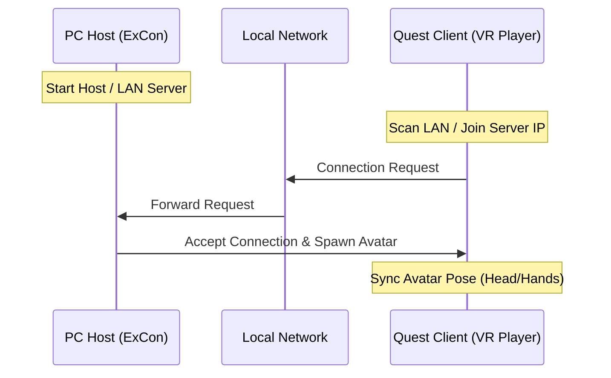
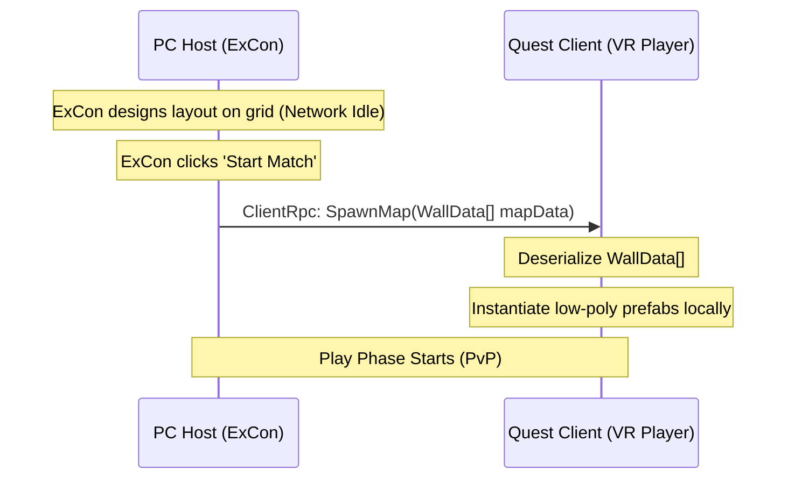

# Project ROADMAP: VR Tactical Simulation (Quest 2 & PC ExCon)

This document outlines the system architecture, core design decisions, system workflows, and step-by-step development phases for the VR Tactical Simulation project.

---

## 1. Architectural Overview & System Concept

The project is a local multiplayer VR Tactical Simulation (similar to Counter-Strike) designed for Meta Quest 2. Although built from a **single Unity project codebase** (which allows both builds to share network code and assets—see [Why a Single Codebase?](#why-a-single-codebase) below), it compiles into two separate platforms with entirely different display and input paradigms:

### Build & Platform Division
* **PC Build (ExCon Host)**:
  * **Target Platform**: Windows Standalone (x86_64).
  * **Role**: Server & Authoritative Host.
  * **UI Style**: 2D Screen-space UI (Flat desktop canvas). Designed for mouse and keyboard control, allowing the Exercise Controller (ExCon) to drag-and-drop objects on a grid, monitor player connections, configure settings, and launch matches.
* **VR Build (Quest Client)**:
  * **Target Platform**: Android (ARM64 - Meta Quest native).
  * **Role**: Client.
  * **UI Style**: 3D Spatial UI (World-space canvases and hand menus). Designed for VR controllers and hand interactions, allowing players to join matches locally, configure their avatar visual settings, and navigate the environment.

### Code & Scene Management
To manage both builds in a single Unity project:
* **Target Build Switcher**: Unity's Build Settings are used to switch platforms (Windows for PC, Android for Quest) prior to compilation.
* **Scene / Assembly Branching**:
  * Build-specific features are separated using Unity preprocessor directives (e.g., `#if UNITY_STANDALONE` vs. `#if UNITY_ANDROID` or `UNITY_XR`).
  * At startup, the game detects the platform or run mode and loads the appropriate entry scene: `PC_ExCon_Scene` for the PC Host and `VR_Client_Scene` for the Quest VR Client.

### Why a Single Codebase?
We use a single Unity project codebase rather than dividing it into two separate projects for several critical architectural reasons:
1. **Shared Network Code**: Both the Host (PC) and the Client (Quest) must use the exact same definitions for RPC methods, network behaviors, and synchronization structures (like the `WallData` struct). Keeping them in a single project ensures they are always in sync and avoids networking protocol mismatch errors.
2. **Shared Assets & Prefabs**: Both builds reference the exact same modular wall blocks, weapon models, bullet projectiles, and player avatar meshes. A single project avoids duplicating large asset files and textures, keeping the project size manageable.
3. **Authoritative Server Verification**: The PC Host functions as the authoritative server. It needs access to the player's collision shapes and weapon settings to validate raycast hits and hits/damage registration. It cannot do this without access to the same prefab definitions used by the VR client.
4. **Local Editor Testing**: With one codebase, developers can playtest the multiplayer logic inside a single Unity Editor session (e.g., using Unity Multiplayer Play Mode or connecting a local standalone build to the Editor).

---

### Hardware & Testing Deployment
The system can be deployed and tested using two different physical hardware configurations:

1. **Standalone Deployment (1 PC + Quest Headsets)**:
   * **PC Machine 1**: Runs the compiled Windows Standalone Build (`PC_ExCon_Scene`). Acts as the LAN Host and Server.
   * **Quest 2 Headsets**: Run the compiled Android APK Build (`VR_Client_Scene`) as standalone mobile devices. No connection to a PC is needed during gameplay.
   * **Networking**: All devices connect wirelessly to the same offline local Wi-Fi 6 router.

2. **Dual-PC Development & Debugging (2 PCs + Quest Headset)**:
   * **PC Machine 1**: Runs the Host/Server (either compiled build or directly within the Unity Editor).
   * **PC Machine 2**: Runs the VR client code within the Unity Editor. A Quest 2 headset is connected to this second PC via a **Link Cable** or **AirLink** (PCVR Mode).
   * **Benefits**: Enables real-time debugging, inspector tracking, and console logging for the VR client side without waiting for Android APK build compilations.

---

## 2. Core Decisions

### Grid-Snapping Build System (PC Host)
* To keep bandwidth usage low, all object placements are stored locally on the PC as lightweight serializable data structures during the **Build Phase**. No network synchronization of individual map elements happens in real time while building.

### One-Time Synchronization Bridge
* When the ExCon clicks "Start Match", the PC serializes the map layout list and transmits it to all clients via a single `ClientRpc`.
* VR Clients receive the array of structs, iterate over them, and instantiate optimized, low-poly prefabs locally.

### LAN / Offline Network Topology
* Configured using **Unity Netcode for GameObjects (NGO)** in a Client-Host model.
* Setup bypasses cloud-based relay systems in favor of local IP connections over local Wi-Fi 6 routers to achieve sub-10ms ping latency.

### Mechanical Gun Trigger Prop
* Rather than using customized Bluetooth or Arduino controller boards which introduce latency, the VR player uses a physical rifle frame where a mechanical lever physically depresses the trigger on the Quest 2 controller. 
* This allows the VR gun trigger to utilize standard Unity XR Input bindings out of the box with zero custom driver overhead.

---

## 3. System Workflows

### Connection & Session Lifecycle


### Map Sync & Phase Transition


---

## 4. Step-by-Step Development Roadmap

```
  Phase 1        Phase 2        Phase 3        Phase 4        Phase 5
 ┌────────┐     ┌────────┐     ┌────────┐     ┌────────┐     ┌────────┐
 │  LAN   │ ──> │ Grid   │ ──> │ Map    │ ──> │ VR Gun │ ──> │ Game   │
 │ Setup  │     │ Editor │     │ Sync   │     │ Input  │     │ Loop   │
 └────────┘     └────────┘     └────────┘     └────────┘     └────────┘
```

### Phase 1: Local Network Integration (LAN Setup)
- **Goal**: Enable direct IP hosting/joining without relying on Unity Gaming Services (UGS) cloud matchmaking.
- **Tasks**:
  1. Configure `UnityTransport` in the NetworkManager to support direct IPv4 connections.
  2. Implement an offline connection panel on the PC desktop interface and Quest VR headset to host and join by entering the Host PC local IP.
  3. Validate connection stability on the local Wi-Fi 6 router.

### Phase 2: PC-side Grid Build System
- **Goal**: Build the map editor functionality on the PC dashboard.
- **Tasks**:
  1. Implement a 3D grid layout overlay (e.g., 3m x 3m grid cells).
  2. Create modular prefabs (Solid Wall, Window Wall, Door Wall) with low-poly colliders.
  3. Implement placement logic: raycast from cursor, snap position to grid cell, select rotation (0, 90, 180, 270 degrees).
  4. Write local serialization logic to save placements to `List<WallData>`.

### Phase 3: Synchronization Bridge
- **Goal**: Sync the built map from PC to Quest clients.
- **Tasks**:
  1. Define the serializable network struct `WallData` containing `prefabId`, `position`, and `rotationY`.
  2. Implement `EnvironmentSyncManager.cs` to hold and coordinate the map database.
  3. Implement `SpawnMapClientRpc(WallData[] mapData)` to broadcast the complete list when starting the match.
  4. Write client-side instantiator that maps `prefabId` to low-poly VR assets and instantiates them with static batching for rendering optimization on Quest.

### Phase 4: VR Player Integration & Gun Input
- **Goal**: Sync VR player movements and physical trigger inputs.
- **Tasks**:
  1. Bind XR Interaction controller triggers to tactical firing actions.
  2. Set up `XRINetworkPlayer.cs` to spawn and sync Quest rigs using `NetworkTransform` components.
  3. Test physical gun prop alignment, ensuring virtual guns map precisely to physical hands.

### Phase 5: Gameplay Loops & Hit Validation
- **Goal**: Set up match phases, hit registration, and player health.
- **Tasks**:
  1. Implement PC-authoritative raycast verification (when VR client fires, send fire request ServerRPC, server calculates line-of-sight and registers damage).
  2. Implement Player Health tracking and synchronize values back to client HUDs.
  3. Build basic match state manager (Warmup -> Build Phase -> Play Phase -> Match End -> Reset).

### Phase 6: Quest 2 Optimization & Hardening
- **Goal**: Ensure solid 72+ FPS on standalone Quest 2 hardware.
- **Tasks**:
  1. Implement static mesh combining for the synced walls to reduce draw calls.
  2. Bake lighting on prefabs or use optimized lightmaps.
  3. Set up automated latency profiling tool for local LAN packet round trips.
